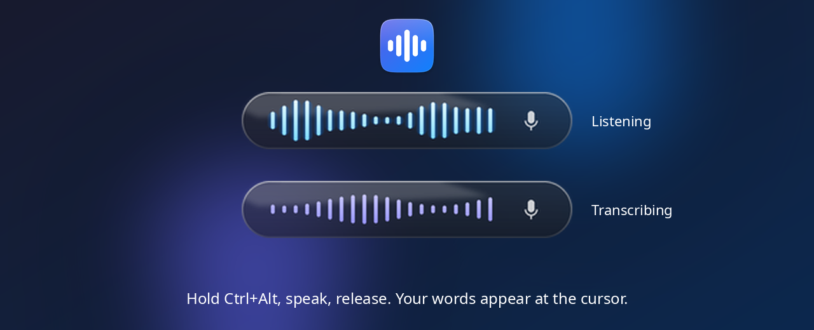

<div align="center">

# nVoice

**Free, offline push-to-talk dictation for Linux.**
Hold <kbd>Ctrl</kbd>+<kbd>Alt</kbd>, speak, release, and your words are typed wherever your cursor is.




</div>

## Why nVoice?

- 🔒 **Private.** Speech recognition runs on your own computer. Your voice never leaves it.
- 💸 **Free.** No account, no subscription, no API key.
- ⌨️ **Works in every app.** Browsers, editors, chat apps, on both Wayland and X11.
- 🪟 **Stays out of the way.** It lives in the system tray, and a small frosted-glass pill shows only while you talk.
- ✨ **Optional cleanup.** If you run [Ollama], a local AI model removes "um"s and fixes punctuation.

## Install

```bash
git clone https://github.com/nVosDzx/linux-nvoice.git
cd linux-nvoice
./setup.sh
```

Then **reboot once**, which gives your user keyboard access. That's it.

`setup.sh` supports **Fedora, Ubuntu/Debian/Mint, Arch/Manjaro and openSUSE**. It installs everything into the project folder and downloads the speech model (~640 MB). See **[install.md](install.md)** for details, troubleshooting and uninstalling.

## Use

Open **nVoice** from your app launcher or the desktop icon, or run `nvoice` in a terminal. It starts in the background with a tray icon, so you can close the terminal.

| Action | Keys |
|---|---|
| Record | hold <kbd>Ctrl</kbd>+<kbd>Alt</kbd> |
| Stop and paste | release |
| Cancel | press any other key while holding (so <kbd>Ctrl</kbd>+<kbd>Alt</kbd>+<kbd>T</kbd> and similar shortcuts still work) |
| Quit | tray menu → **Quit**, <kbd>Ctrl</kbd>+<kbd>Alt</kbd>+<kbd>Q</kbd>, or `nvoice --quit` |

```bash
nvoice              # start in the background
nvoice --no-llm     # skip the optional AI cleanup
nvoice --quit       # stop it
nvoice -f           # stay in the terminal and show the log live (debugging)
```

The tray icon turns blue while you're talking and indigo while it transcribes. Its menu lets you turn AI cleanup on or off, open the settings or the log, and quit. You can drag the pill anywhere on screen.

## Configuration

Everything is in [`config.yaml`](config.yaml), and every setting has a comment. The most useful ones:

| Setting | What it does |
|---|---|
| `hotkey.hold` | The keys to hold (`ctrl`, `alt`, `shift`, `super`) |
| `paste.combo` | `ctrl+v` by default. Use `ctrl+shift+v` if you mostly dictate into terminals |
| `stt.*` | Switch to the faster `tiny` model (install it with `./setup.sh --tiny`) |
| `ui.glass_opacity` / `ui.blur` | How see-through the pill is, and the frosted blur behind it (KDE Plasma) |
| `llm.*` | Ollama address, model and prompt for the optional cleanup |

Restart nVoice after changing settings.

## How it works

```
hold Ctrl+Alt ─► record mic ─► Whisper (speech → text, on your CPU) ─► optional Ollama cleanup ─► paste at cursor
```

Speech recognition uses OpenAI's open-source **Whisper** model, run by [sherpa-onnx]. Hotkeys are read directly from the keyboard device and the paste is sent through a virtual keyboard, which is what makes it work on Wayland. See **[description.md](description.md)** for a tour of every file.

## Troubleshooting

| Problem | Fix |
|---|---|
| `no readable keyboards` or text is copied but not pasted | Reboot after running `setup.sh`. `id -nG` should list `input`. |
| Nothing is pasted in a terminal | Set `paste.combo: "ctrl+shift+v"` in `config.yaml`. |
| No tray icon on GNOME | Install the "AppIndicator and KStatusNotifierItem Support" extension. nVoice works without it. |
| Something else | Check the log at `~/.local/state/nvoice/nvoice.log`, or run `nvoice -f`. |

## License

[MIT](LICENSE). Free to use, change and share.

[sherpa-onnx]: https://github.com/k2-fsa/sherpa-onnx
[Ollama]: https://ollama.com
